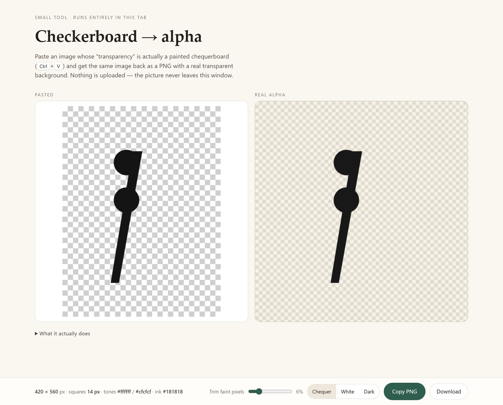

# Checkerboard → alpha

**Live:** <https://appleknife.github.io/checkerboard-to-alpha/> — drop in a screenshot, get a PNG back.

Some screenshots call transparency a *checkerboard* and paint it in as real pixels.
The rest of the picture is fine; only the background is wrong. This tool takes such an
image and gives it back as a PNG with a genuine transparent background, keeping the
antialiased edges it had.

Paste with `Ctrl`+`V`, then **Copy PNG** or **Download**. Nothing is uploaded — there
is no server, no account, no analytics, and the picture never leaves the tab.

---

## Using it

1. Copy the image (`Ctrl`+`C` from wherever it is — a screenshot tool, a web page, a file).
2. Open the page and press **`Ctrl`+`V`**. It converts as soon as it lands. You can paste
   again at any time, or drop a file onto the window.
3. **Copy PNG** puts the result on the clipboard; **Download** (or `Ctrl`+`S`) saves it.

The left panel shows what you pasted (on white, because it is opaque). The right panel
shows the result, and **Chequer / White / Dark** change only that backdrop — dark is the
quickest way to spot leftovers.

**Trim faint pixels** is the one knob worth knowing. JPEGs leave a soft halo wherever a
dark edge meets the background; raising this drops those pixels. 6% handles most
screenshots. If you can still see a ghost of the squares in the result, raise it.

## What it actually does

* It finds the **two tones** the chequerboard is made of. A screenshot that arrived as a
  JPEG has each tone spread over a small cluster of levels (`255` and `203/204/205…`), so
  the histogram is smoothed and the two strongest peaks are taken, then each peak's
  cluster is averaged.
* It measures the **square size** from the run lengths along the rows — in a chequerboard
  every run of one tone is exactly one square wide — and then builds a phase map to know
  which square sits under each pixel. A chequer tile repeats every *two* squares, which
  is why the map's period is twice the square you see.
* Alpha is `(square tone − pixel) / (square tone − ink)`. Anything at or lighter than the
  darker square is empty, which is what removes the seams between squares.
* Monochrome art is flattened to a single ink colour; colour art is un-mixed from the
  square it sat on so no pale fringe survives.

It copes with odd zoom levels (a 1.37× screenshot with 19 px squares works), with images
that are already transparent (returned untouched), and with plain flat backgrounds (the
flat colour is keyed out). A dark image is reported rather than mangled.

## A note on the clipboard

Copying an image needs a secure context and the page in focus; a page opened straight off
a disk (`file://`) is treated differently by each browser, and several refuse the
clipboard outright. When that happens the tool says so in the line under the dimensions
and saves the PNG to your Downloads folder instead. **Download always works.**

## Running it yourself

`index.html` is self-contained: no build step, no dependencies, no external assets. It
works offline by double-clicking the file, and equally well from any static host — there
is no server-side anything, so GitHub Pages, Netlify or a USB stick all behave the same.

## Licence

The tool is free to use and modify. It contains no third-party code or fonts.
